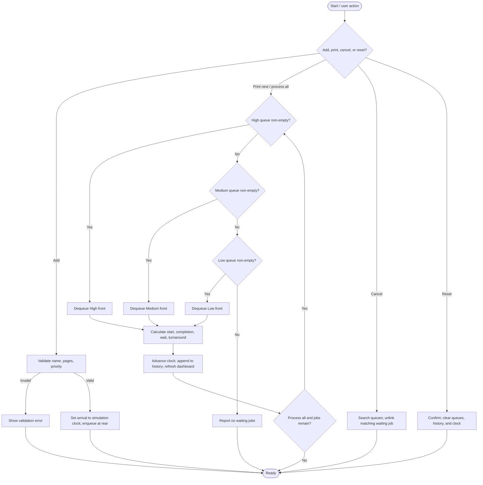

# Multi-Level Printer Job Scheduler

An educational printer scheduling simulation for a Data Structures mini-project. The browser dashboard and C++17 console program are independent implementations; there is no local backend connecting them. The C++ console scheduler uses four priority levels and a `std::priority_queue`; the browser dashboard retains its three-level linked-queue simulation.

## Abstract and problem statement

Print requests may have different urgency, but a single printer can serve only one job at a time. The C++ scheduler processes Critical, High, Medium, and Low jobs in that order, preserving first-in, first-out (FIFO) order within each level. It records chrono-based arrival, start, and completion timestamps, plus waiting time. The browser dashboard remains a separate three-level simulation.

## Objectives and scope

- Demonstrate a C++ priority queue with a custom comparator and a browser linked-queue implementation.
- Apply strict priority selection with FIFO order within each priority.
- Show waiting queues, printer state, completed jobs, simulation time, and summary statistics.
- Provide both a responsive browser simulation and a standalone interactive C++17 console implementation.
- Model one page as one **simulated second**. This assumption makes the timing calculations easy to demonstrate; it is not a measurement of real printer speed.

The simulation runs locally in the browser or console. The frontend is not integrated with the C++ program, and neither version communicates with a physical printer.

## Project structure

```text
.
├── cpp/
│   └── printer_scheduler.cpp  # Standalone C++17 application and tests
├── index.html                 # Browser dashboard markup
├── public/
│   └── style.css              # Responsive dashboard styles
├── src/
│   └── main.js                # Browser scheduler with custom linked queues
└── README.md
```

## System architecture

```text
User input
   ├── Browser dashboard → JavaScript scheduler → three linked queues → completed history / statistics
   └── Console menu       → C++17 scheduler       → priority queue → completed history / statistics
```

Each implementation owns its scheduler state. The browser animates a selected job briefly for feedback. The C++ simulation uses `std::chrono::system_clock` timestamps and advances its logical completion time by one simulated second per page; it does not wait one real-world second per page.

## Data structure design

The C++ `PrintJob` stores an automatically generated ID, document name, page count, priority, monotonically increasing arrival order, and chrono timestamps for arrival, start, and completion. A custom `std::priority_queue` comparator sorts by lower-numbered priority first, then by earlier arrival order. The completion-history vector stores processed jobs in dispatch order. Cancellation rebuilds the heap while omitting the selected waiting job. The browser uses its own linked-list queues.

## Scheduling algorithm

The C++ strict priority order is Critical (1), High (2), Medium (3), Low (4). The priority queue selects the smallest priority number, then the smallest arrival counter. It never lets a lower priority job pass a waiting higher priority job; jobs at the same priority are removed in their original arrival order.

```text
ADD(name, pages, priority):
    reject blank name, pages outside 1..10000, or invalid priority
    job.arrivalOrder = nextArrivalOrder++
    job.arrivalTime = max(current time, simulationClock)
    push job into priority queue

PRINT_NEXT:
    if queue is empty: report that no job is waiting
    else: job = pop highest-priority, earliest-arriving job

    job.startTime = max(simulationClock, job.arrivalTime)
    job.completionTime = job.startTime + seconds(job.pages)
    waiting = job.startTime - job.arrivalTime
    turnaround = job.completionTime - job.arrivalTime
    simulationClock = job.completion
    append job to completed history
```

### Flowchart

Browser dashboard flowchart (three-level implementation):



## Timing and important functions

- `JobComparator`: order jobs by priority and then arrival counter.
- `PrinterScheduler::addJob` / `processNext`: submit and process jobs, calculate chrono timestamps, advance simulated time, and save completion order.
- `PrinterScheduler::cancelJob`: rebuild the priority queue without the matching waiting job.
- `PrinterScheduler::displayQueues` / browser render functions: show waiting jobs and completed history.
- `process all`: repeatedly applies the same one-job dispatch rule until no jobs remain.

For each completed job:

```text
Waiting time    = Start time − Arrival time
Turnaround time = Completion time − Arrival time
```

## Complexity analysis

For the C++ scheduler, let `n` be the number of waiting jobs.

| Operation                  | Complexity | Reason                                                                 |
| -------------------------- | ---------: | ---------------------------------------------------------------------- |
| Operation                | Complexity | Reason                                                                  |
| ------------------------ | ---------: | ----------------------------------------------------------------------- |
| Submit                   | O(log n)   | Insert into the binary heap.                                            |
| Process next             | O(log n)   | Remove the highest-priority job from the heap.                          |
| Display queue            | O(n log n) | Pop from a copy to display jobs in processing order.                    |
| Cancel a job             | O(n log n) | Drain and rebuild the heap while omitting the matching ID.              |
| Process all waiting jobs | O(m log m) | Process each of `m` jobs from the heap.                                 |
| Storage                  | O(n + h)   | Waiting heap plus `h` completed-history entries.                        |

The browser UI also creates one display element per visible job; that rendering cost does not change the queue operations themselves.

## Test cases

Run the C++ automated checks with `printer_scheduler.exe --test` (or `./printer_scheduler --test` where applicable). They cover:

| Case                                        | Expected result                                                                                                        |
| ------------------------------------------- | ---------------------------------------------------------------------------------------------------------------------- |
| All queues empty                            | Print-next returns no job; no crash or history entry.                                                                  |
| One job at each priority                    | Print order is Critical, High, Medium, Low.                                                                             |
| Multiple jobs at same priority              | Jobs complete in their enqueue/arrival order.                                                                          |
| Low submitted before High                   | Waiting High is selected first.                                                                                        |
| Cancel waiting job                          | Matching job is removed; other jobs remain in order.                                                                   |
| Invalid pages, blank name, invalid priority | Request is rejected; queues are unchanged.                                                                             |
| Process all                                 | All waiting jobs are completed; waiting count becomes zero.                                                            |
| Timing calculations                         | A 5-page job completes 5 simulated seconds after start; the following job starts at that completion and records its wait. |

The browser form also validates name and page count. Each waiting job has a cancellation control; completed jobs cannot be cancelled.

## Demonstration data

Click **Load demo** in the dashboard or add these requests in the console:

| Document       | Pages | Priority | Arrival |
| -------------- | ----: | -------- | ------: |
| Assignment A   |    10 | Low      |      0s |
| Exam Paper     |     5 | High     |      0s |
| College Notice |     3 | Medium   |      0s |
| Lab Report     |     8 | High     |      0s |

With that submission order, strict priority and FCFS produce **Exam Paper → Lab Report → College Notice → Assignment A**. The high-priority jobs keep their relative arrival order. If printed continuously, the simulated intervals are 0–5, 5–13, 13–16, and 16–26 seconds.

## Build and run on Windows / VS Code

### C++17 console program

Install a C++17 compiler (for example, MinGW-w64 g++) and make sure `g++` is on `PATH`. Open the project folder in VS Code, then use its terminal:

```powershell
g++ -std=c++17 -Wall -Wextra -pedantic cpp\printer_scheduler.cpp -o printer_scheduler.exe
.\printer_scheduler.exe
```

Run the automated test cases:

```powershell
.\printer_scheduler.exe --test
```

The menu supports adding jobs, printing the next job, processing all jobs, viewing queues/history/statistics, cancelling a waiting job by its numeric ID, resetting with confirmation, and exiting.

### Browser dashboard

Install Node.js, open the project folder in the VS Code terminal, then run:

```powershell
npm install
npm run dev
```

Open the local URL printed by Vite (normally `http://localhost:5173`). To create a static production build, run `npm run build`; the output is written to `dist/`. No server-side integration or database is required. The dashboard can also be opened as static files after building/serving the output; Vite's development server is the easiest local option.

## Limitations and future enhancements

- Strict priority can cause **starvation**: a continuous stream of high-priority jobs may delay low-priority jobs indefinitely.
- Priority aging could gradually raise a job's effective priority based on its waiting time. That would improve fairness but intentionally changes strict priority behavior.
- The one-second-per-page model ignores printer speed variation, setup time, duplexing, failures, and physical paper limits.
- Browser data exists only for the current page session and is not synchronized with the C++ program.
- Potential extensions include persistence, a configurable page duration, pause/resume, job editing, multiple printers, estimated completion time, and starvation/aging visualizations.

## Conclusion

The project demonstrates linked queues in the browser and heap-based strict-priority scheduling in C++, with FIFO tie-breaking and time accounting. C++ test mode verifies the console scheduler while the browser dashboard provides a separate interactive simulation.
# multi-level-printer-simulator

# multi-level-printer-simulator

